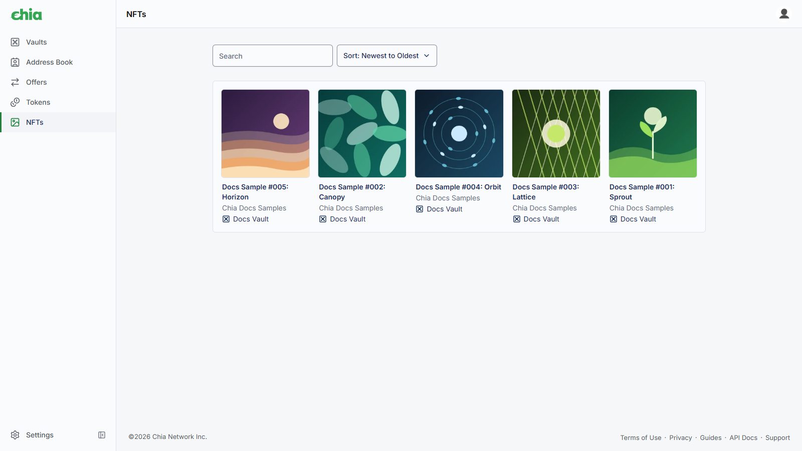
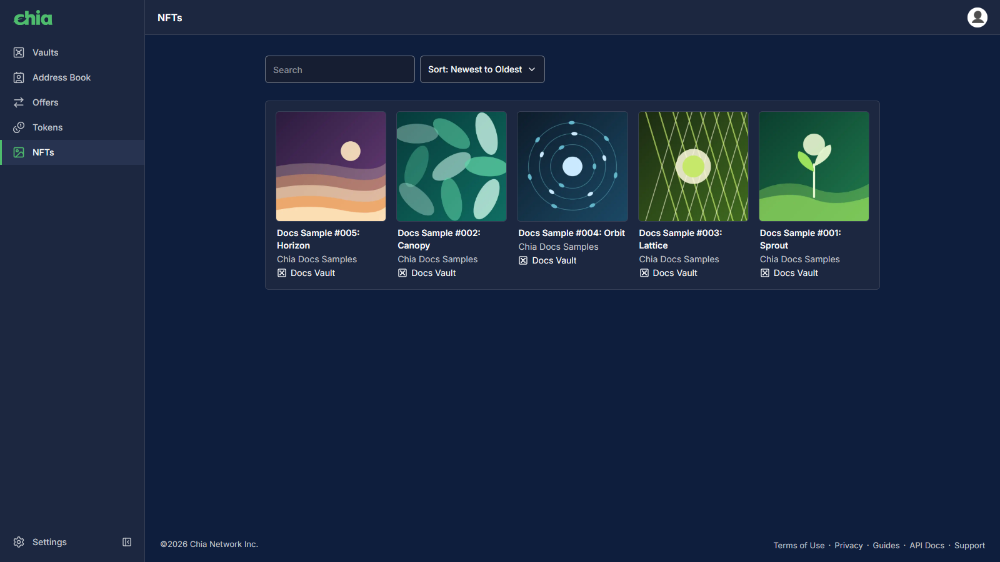
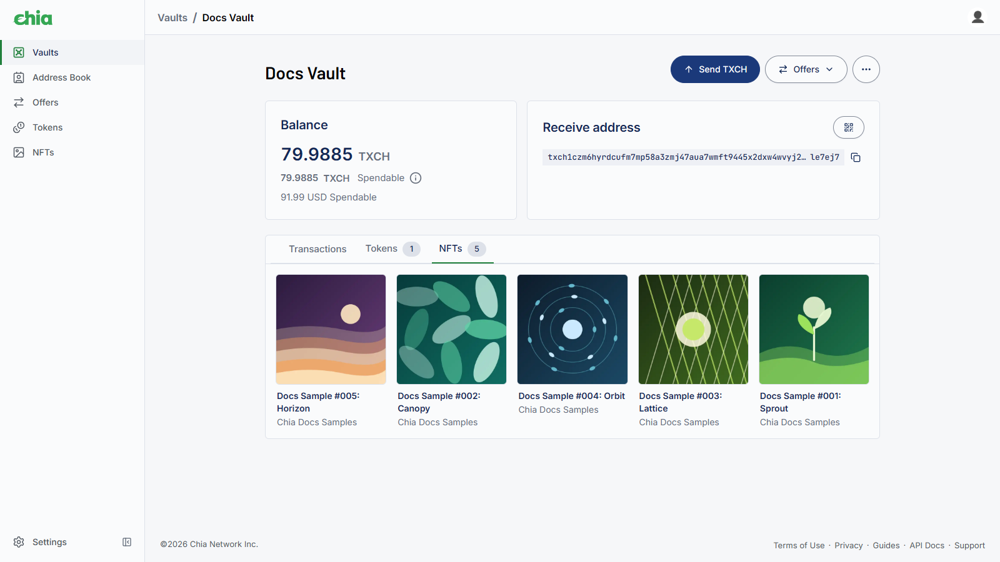
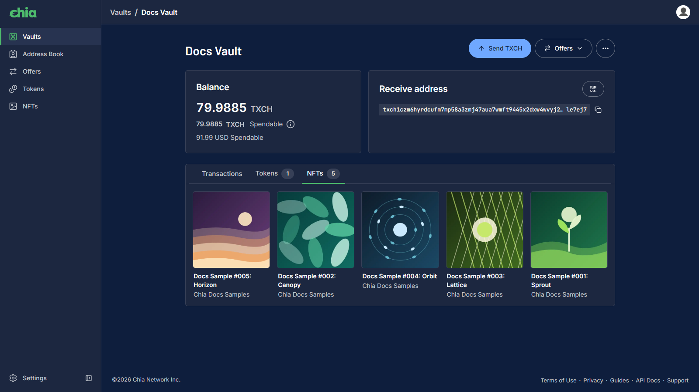
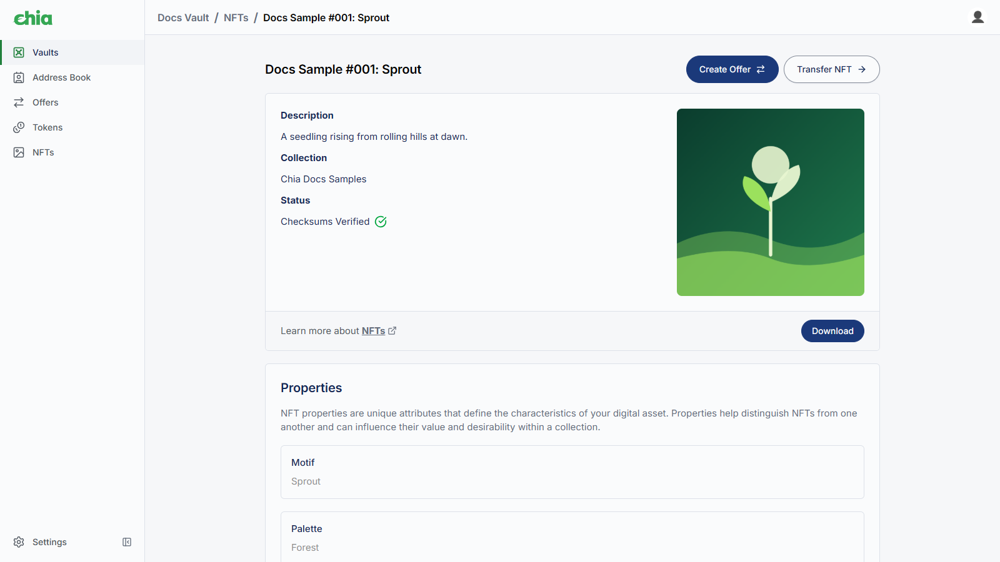
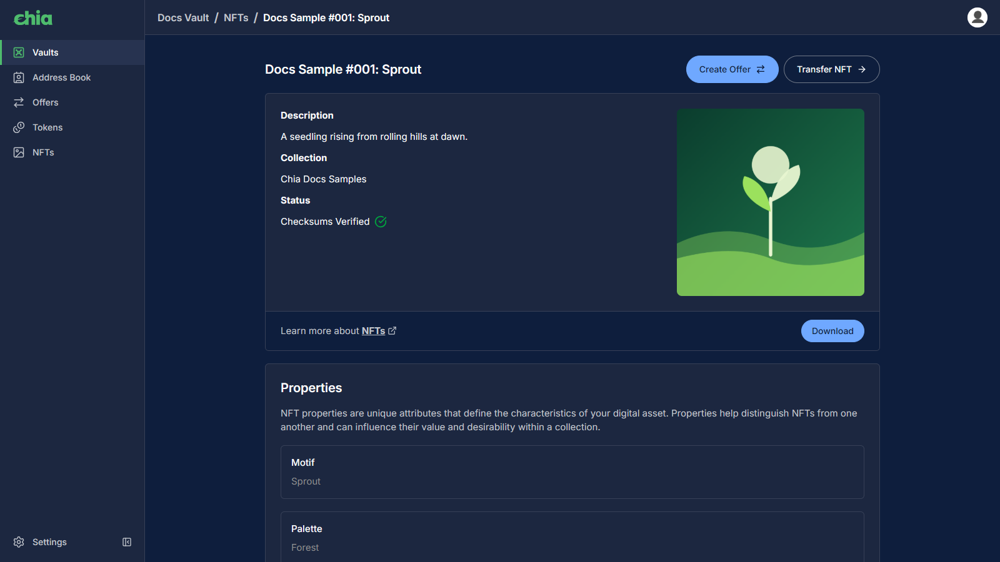
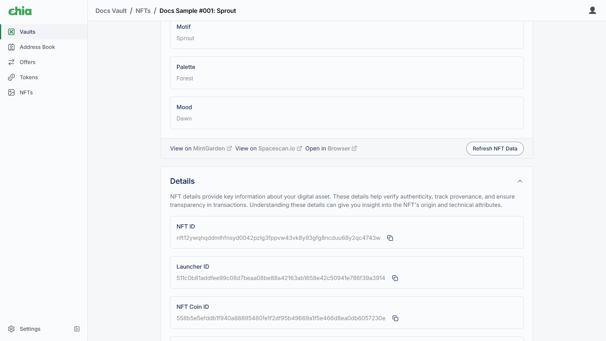
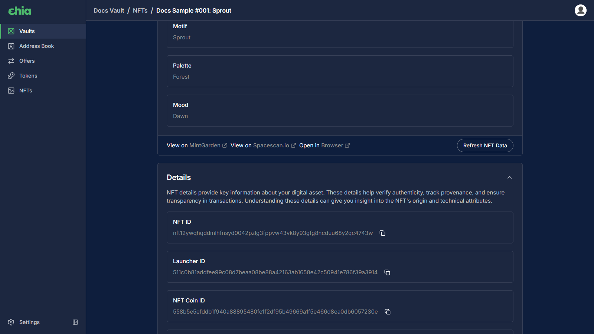
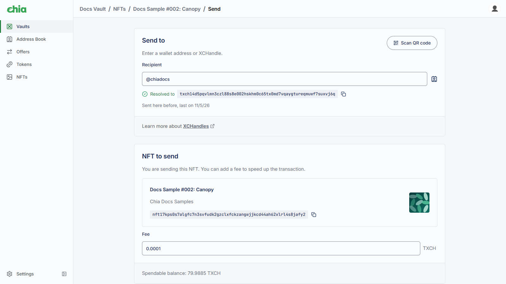
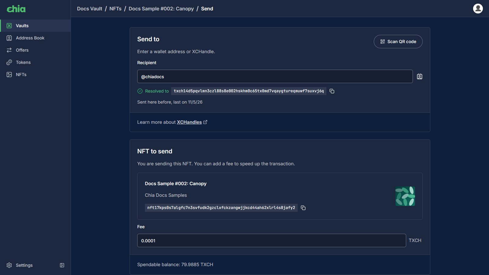

This guide shows how to view and send NFTs in the Chia Cloud Wallet.

:::info

You need a Cloud Wallet account and at least one vault. If you have not created a vault yet, follow the [Getting Started Guide](/cloud-wallet/getting-started) first.

:::

## Prerequisites

- An active [Chia Cloud Wallet](https://vault.chia.net/) account with at least one vault
- Access to your vault spend key (Chia Signer app or passkey) to sign NFT send transactions

## Open NFTs

You can browse NFTs from the left-hand menu or from a vault.

### From the left-hand menu

1. Log in to your [Chia Cloud Wallet](https://vault.chia.net/) account.

2. Open `NFTs` from the left-hand menu.

3. Use `Search` and `Sort` (`Oldest to Newest` or `Newest to Oldest`) to find an NFT.

  
  

If you do not own any NFTs yet, the empty state is titled `Add Your First NFT`. NFTs you receive into a vault appear here after they arrive. You can also browse NFTs on [Dexie](https://dexie.space/nft) and [MintGarden](https://mintgarden.io).

### From a vault

1. Open the vault.

2. Select the `NFTs` tab.

  
  

The vault tab lists NFTs in that vault only.

## View NFT details

1. Click an NFT card from the list or from a vault `NFTs` tab.

2. Review the details page. Typical fields include `Description`, `Collection`, and `Status`. The status shows whether the off-chain data matches the on-chain checksums: `Checksums Verified`, `Checksum Mismatch`, `Unable to Verify Checksums`, or `Verifying Checksums`. A verified status does not confirm who minted the NFT.

  
  

3. Open `Properties` for attributes, and expand `Details` for identifiers such as `NFT ID` and `Launcher ID`.

  
  

4. Use the `MintGarden` and `Spacescan.io` links to open the NFT on [MintGarden](https://mintgarden.io) or [Spacescan](https://www.spacescan.io). You can also browse NFTs on [Dexie](https://dexie.space/nft).

Off-chain metadata is sourced from [MintGarden](https://mintgarden.io). If that data cannot load, the page shows a warning and some sections may be unavailable.

The details page also lets you download the NFT file, create an [offer](/cloud-wallet/offers), or burn the NFT. Burning is permanent and cannot be undone.

## Send an NFT

1. On the NFT details page, click `Transfer NFT`.

2. Under `Send to`, enter or paste the destination in `Recipient`, pick a saved contact from your [Address Book](/cloud-wallet/address-book), or use `Scan QR code`. Wallet addresses start with `xch1` on mainnet. You can also enter an [XCHandle](/cloud-wallet/xch-handles), which starts with `@`.

3. Review `NFT to send`. Enter a `Fee` if you want to speed confirmation. The card shows your spendable balance.

4. Optionally add a `Memo` of up to 100 characters.

  
  

5. Click `Send`. Review the `Confirm Transaction` dialog (`Sign and Send` for a passkey, or approve the request in the Chia Signer app).

## Troubleshooting

- Confirm `NFTs` appears in the left-hand menu and that the NFT is in the selected vault
- If details look incomplete, try `Refresh NFT Data` on the details page
- For signing problems, confirm your Chia Signer app or passkey can approve the `Confirm Transaction` request
- For additional support, use [In App Support](/cloud-wallet/in-app-support)
